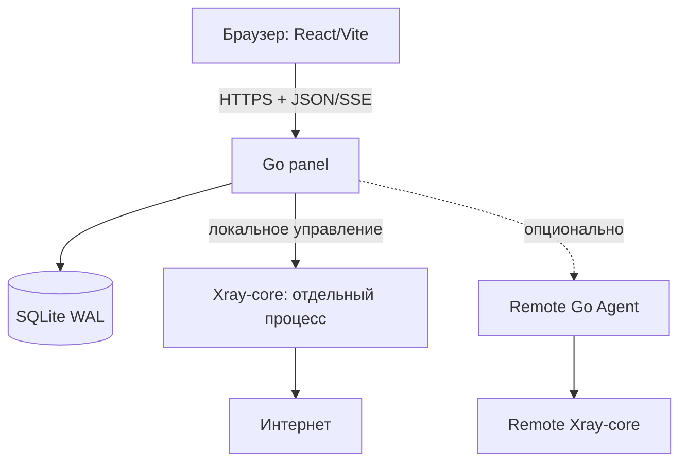

# Архитектура: процессы и режимы

## Приоритет: standalone/hybrid на одном VPS

**На одном VPS** запускаются Go-панель и Xray; отдельного агента нет. **При расширении** тот же кодовый проект запускает облегчённый удалённый агент на другом VPS, рядом с его Xray. Панель не проксирует пользовательский трафик и не становится транзитным VPN-узлом автоматически.

## Режимы

| Режим | Панель | Локальный Xray | Удалённые агенты | Когда нужен |
|---|---|---|---|---|
| standalone | да | да | нет | один личный VPS |
| hybrid | да | да | да | панель + свои VPN + другие VPS |
| controller | да | нет | да | отдельное управление |
| node | нет | да | исходящий управляющий канал | удалённый VPS |

В реализации допустим один Go-бинарник с запуском по subcommand/конфигурации; разделять бинарники только при доказанной экономии. Границы безопасности при этом должны быть не логическими флагами, а реальными ограничениями прав процессов.

## Основные подсистемы

- HTTP/API/Auth: административные сессии, безопасность, конфигурация и JSON-API.
- Users: пользователи и учётные данные конкретного протокола/устройства.
- VPN Profiles/Inbounds: логические конфигурации, независимые от физических серверов.
- Nodes: физические VPS, роли, применение ревизий, статус, SSH bootstrap.
- Routes: прямые и каскадные маршруты, резервные выходы.
- Subscriptions: стабильный ID подписки, форматирование под клиентов, резервные адреса.
- Security/Operations: firewall, SSH, сертификаты, обновления, backup.
- Telemetry: агрегированные метрики, health checks и системные события.

## Потоки изменений

1. Администратор меняет **желаемое состояние** через API.
2. Service валидирует политику, repository сохраняет новую ревизию и audit/operation в одной локальной транзакции.
3. Применитель получает ограниченную задачу, строит конфигурацию Xray и список firewall-изменений.
4. Проверка параметров, сертификатов, портов и схемы до фактического применения.
5. Сначала безопасные подготовительные операции, затем переключение конфигурации и внешняя проверка.
6. Подтверждение применённой версии; в случае сбоя rollback и статус `degraded`/`failed` вместо ложного `ok`.
7. Subscription publisher публикует новую версию **после** подтверждения работоспособности нового входного endpoint.

## Жизненный цикл

`internal/app` собирает ресурсы один раз, запускает HTTP и bounded background jobs. Shutdown: остановить приём новых операций → завершить/отменить bounded work → остановить HTTP с дедлайном → закрыть Xray adapters и SQLite. Никаких новых goroutine на пользователя без лимита.

## Управление Xray

Xray API — для поддерживаемых динамических операций; изменение не поддерживаемой API конфигурации — через атомарно записываемый файл и контролируемый restart/reload, с удержанием старой рабочей версии. Конкретные операции API проверить по версии Xray при реализации.

## Важные ограничения

- Нода не считается VPN-работоспособной только по heartbeat.
- Один VPS не даёт настоящей резервной входной/выходной ноды.
- Автопереключение *новых* соединений отличается от сохранения уже открытой TCP-сессии.
- Отсутствие собственного домена не означает анонимность IP.
- Сервисы локального управления имеют отдельные административные и сетевые полномочия.

## Автоматизация и ручные переопределения

Нода/подключение/маршрут хранят не только значение настройки, но и её происхождение (`auto/manual/imported`) и применённую ревизию. Генератор desired config не имеет права стирать ручное переопределение без конфликта и explicit approval. Изменения включают план/проверку/применение/внешнюю проверку/компенсацию. Подробности: [автоматизация](../features/automation-and-advanced.md), [установщик](../features/nodes-and-installer.md), [security model](../security/threat-model.md).

Два представления списка серверов — схема и таблица — используют один backend contract. Frontend не вычисляет сетевой маршрут по картинке; отображает подтверждённые на backend logical routes и health.
