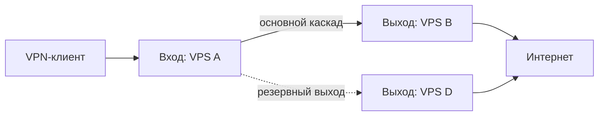

# Экран «Серверы и маршруты»: схема и таблица

**Статус:** целевая спецификация. На 2026-11-05 реализован отдельный редактор draft-маршрутов со схемой React Flow, общей формой и таблицей ([объём](../release-0.7.0-stage5-routing-ui.md)); единый экран всей опубликованной инфраструктуры, runtime health и apply ещё не реализованы. **Требование:** два равноправных представления *одних и тех же данных*, быстро переключаемые в UI. Не смешивать граф управления панелью и граф прохождения VPN-трафика.

## 1. Представление «Схема»

- Компактная, масштабируемая карта связей: **клиенты → входные ноды → выходные ноды → интернет**.
- Нода показана небольшой карточкой: короткое имя, роль (`вход`, `выход`, `универсальная`, `резерв`), статус, IP (с возможностью скрыть), задержка (только проверенная), health маршрута.
- Связи между VPS: **сплошная стрелка = реальный путь трафика**, **пунктир = управление/конфигурация**. Отдельный переключатель «Показать управление»; по умолчанию только VPN-маршруты.
- Основной маршрут визуально отличим от резерва. Цвет **не единственное** кодирование: подпись `основной/резерв`, тип линии и значок статуса.
- Выход через эту ноду подписан `Выход в интернет`, но не показывается там, где нода только принимает и передаёт далее.
- Для каждой связи доступна карточка: протокол, порт, режим, статус последнего egress-probe, время проверки, возможная ошибка, целевой exit-IP.
- Ноды можно выбирать кликом и клавиатурой. Выбор открывает боковую панель с действиями (редактировать роль, диагностика, заменить, режим обслуживания).
- Длинные цепочки и десятки нод группируются по логическому маршруту/группе; layout без пересечений в простом случае. Zoom/pan — по мере реальной необходимости.
- Поддержать виды: «Все маршруты» и «Выбранный маршрут». Не тратить CPU браузера на анимацию каждого пакета или принудительный физический граф-layout.
- Браузерная схема отображает последний опубликованный снимок и его timestamp; при пропаже SSE остаётся статичной с меткой «данные могут быть устаревшими».

**Примечание к примеру:** пунктир `A → D` означает резервный VPN-маршрут *только в этом конкретном примере*, а не управляющее соединение. В реальном UI резервный VPN-маршрут рисуется отдельным типом линии и подписывается; управление выводится отдельным overlay. Не выводить смешанное смысловое обозначение пунктиров без легенды.

### Никакой географической предвзятости

Первым может быть зарубежный, российский или локальный сервер; страна — только метаданные, а роли назначаются явно. Один VPS может обслуживать пользователей напрямую либо быть входом/выходом каскада.

## 2. Представление «Таблица»

Те же сущности доступны как таблица без потери функций:

| Колонка | Смысл |
|---|---|
| Сервер | Имя, идентификатор, адрес по запросу |
| Роль | Вход / выход / резерв / универсальный |
| Состояние | Достижимость, Xray, health VPN, возраст данных |
| Маршруты | Прямой / каскад / резерв, число связей |
| Нагрузка | CPU, RAM, сеть, активные соединения |
| Ресурсы | Свободный диск, версия ОС/Xray, uptime |
| Действия | Проверка, детали, обслуживание, замена, удаление |

- Колонки настраиваемые; серверная пагинация/фильтры для большого списка.
- Сортировка/фильтры и выбор сущности сохраняются при переходе между представлениями.
- Быстрый выбор двух серверов и действие «Создать маршрут», без ручного JSON.
- Таблица должна быть полностью доступна без Canvas/drag-and-drop.

## 3. Синхронизация двух видов

- Один query/cache-store и единые серверные DTO; **не дублировать бизнес-модель** отдельно под граф и таблицу.
- Переключатель вида: сегментированные кнопки `Схема | Таблица`, состояние можно сохранять в URL и локальном интерфейсе (не в sensitive storage).
- Фильтр `Все / С ошибками / Входы / Выходы / Резервы` общий; выделенный маршрут одинаков в обоих видах.
- Обновления через TanStack Query + SSE: события должны инвалидировать минимально нужные запросы; при разрыве — controlled refetch.
- На мобильном экране по умолчанию таблица-карточки; схема поддерживает прокрутку/масштаб без блокировки жестов страницы.

## 4. Конструктор маршрутов

1. Выбрать тип: `Прямой`, `Каскад`, `Каскад с резервом`, `По правилам`.
2. Выбрать входную ноду.
3. Выбрать основной и резервные выходы, если нужны.
4. Показать **предпросмотр графа** и конкретный план (порт, протокол, credentials, firewall, ожидаемый внешний IP).
5. Проверить и применить; отобразить per-node ход операции и итог.

При неработающем входе сценарий нельзя показывать как «бесшовный failover»: для него нужен резервный профиль клиента.

## 5. Точные визуальные правила

Сохраняем характер 3x-ui: тёмный графитовый фон, умеренный синий акцент, компактность, тонкие бордеры, табличная плотность. Не копируем сторонний CSS, макет 1:1 или интеллектуальную собственность. Токены — только из `design-system.md`. Для схемы: чёткие коннекторы и легенда, читаемые роли, отсутствие бессмысленных анимаций. Кнопки/иконки не меняют положение при раскрытии боковой панели.

## 6. Состояния для проверки

`empty` (1 VPS, нет каскада), `standalone`, `2 VPS direct`, `2 VPS cascade`, `3 VPS with fallback`, `node offline`, `xray failed`, `route broken`, `subscription stale`, `SSE disconnected`, `permission denied`.

## План упрощения — 2026-11-05

Последовательные мастера, схема как дополнительное представление, мобильный сценарий без обязательного drag-and-drop и разделение обычных/расширенных форм описаны в [едином плане](../planning/ux-and-safe-automation-2026-11-05.md). Это целевое изменение UX, не новый статус реализации.
