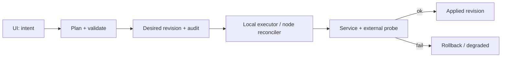

# Feature: автоматизация по умолчанию и расширенные настройки

**Статус:** требования, не реализация. **Владелец:** automation/deploy + каждая предметная фича. **Публичный UX:** «Просто работает», при этом все управляемые настройки доступны по необходимости.

## Продуктовый контракт

1. Обычная операция выполняется через понятный сценарий: **выбрать цель → посмотреть безопасный план → применить → увидеть проверенный результат**.
2. По умолчанию система сама создаёт параметры Xray, идентификаторы, ключи, корректные Inbound/Outbound, разрешения портов и настройки подписок. Это *управляемые настройки*; они не должны быть скрыты навсегда.
3. Каждый автоматически выбранный параметр имеет: `value`, `source` (`auto`/`manual`/`imported`), `owner`, `revision`, `validation_status`, `last_changed_at`.
4. В расширенном режиме можно увидеть вычисленное значение, его смысл, совместимость, последствия изменения и вернуть «Автоматически».
5. Ручное переопределение не должно молча стираться при новой синхронизации. Если новая автоматическая конфигурация конфликтует с ручной, операция переходит в `needs_attention`, с diff и явным решением пользователя.
6. Нельзя маскировать отказ под успех. Показать «сохранено в панели», «применяется к ноде», «подтверждено Xray», «VPN проверен извне» — разные состояния.

## Что автоматизируем

| Операция | Автоматическое поведение | Разрешённое ручное управление |
|---|---|---|
| Добавить сервер | SSH preflight, бинарники, агент, identity, systemd, firewall, проверка VPN | ОС/репозиторий, SSH-порт, роль, версия движка, политика безопасности |
| Создать подключение | Профиль, ключи, свободный порт, firewall, генерация ссылки | Inbound, транспорт, Reality/SNI/ALPN и иные совместимые параметры |
| Создать пользователя | Уникальные credentials, лимиты по политике, нужные профили и ноды | Квоты, expiry, IP/HWID, выбор серверов, режим first-use |
| Добавить каскад | Межнодовые учётные данные, маршруты, порты, end-to-end probe | Вход, выход, резерв, правила домена/IP, fail-policy |
| Добавить резерв | Проверки, антифлап, переключение *новых* соединений, метрики | Порог проверок, priority, cooldown, fail-open только явно |
| Удалить подключение | Проверить зависимости и managed firewall rule | Явный выбор, что оставить, удаление с подтверждением |
| Заменить VPS | Поднять новую ноду, перенести логическую роль, проверить и опубликовать | Изменение профиля, ключей, периода DNS/клиентской подписки |
| Обновление | Проверенная версия, snapshot, staged apply, health/rollback | Окно обновления, pin-версии, отложить |

## Три уровня сложности UI

- **Обычный:** минимум полей, безопасный профиль с понятным результатом. Указывать только назначение (VPN/вход/выход/резерв) и предпочтения.
- **Дополнительно:** протокол/транспорт, порт, портовая политика, TLS, список серверов, quota, GeoIP, ограничения.
- **Экспертный:** полный нормализованный Xray-конфиг, diff desired/applied, детальная маршрутизация, системный журнал. Редактор raw JSON должен иметь schema/version validation и explicit ownership; ручной JSON не должен быть перезаписан «автоматикой» без предупреждения.

Уровни интерфейса не эквивалентны уровню полномочий. Backend проверяет права на каждую операцию вне зависимости от режима UI.

## Технический механизм

- План должен содержать списки **что добавится / что изменится / что будет закрыто / какой доступ останется**, включая влияние на пользователей и подписки.
- Ошибка шага не оставляет ложного «всё применено». Межнодовые операции не атомарны: требуется журнал шагов, идемпотентность и компенсирующие действия.
- Операции имеют `operation_id`, `requested_by`, `expected_revision`, cancellation policy, deadline, states `planned/preparing/applying/verifying/succeeded/degraded/failed/rolled_back`.
- Настройки, влияющие на доступность SSH, панель, входные IP или DNS, требуют подтверждения и гарантированного доступа для восстановления.
- Адаптивные health-probes, лимиты параллелизма, backoff, кэш метрик: не увеличивать фоновые затраты на малых VPS.

## UX ошибки

Сообщение должно отвечать: **что не получилось → что затронуто → осталось ли соединение рабочим → что делать дальше**. Кнопки «Повторить», «Показать подробности», «Вернуть рабочую версию» показываются только если действие допустимо.

## Acceptance

- Пользователь создаёт VLESS+Reality и получает рабочую ссылку без ручного Xray JSON и UFW.
- Меняет порт: UI показывает diff + TCP/UDP правила; порт снаружи проверен.
- Изменяет экспертную настройку: ревизия сохраняет provenance; следующий автоматический rollout её не стирает.
- Ошибка при сетевой операции: показан `degraded`, рабочее соединение/SSH по возможности восстановлено, причину можно диагностировать.
- Все секреты masked; попытка вывода в JSON/логи блокируется тестами.
